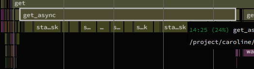
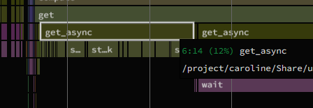

# dCache benchmarking for DePSI full processing

This directory contains scripts and profiling results for benchmarking dCache performance in the context of DePSI full processing. For test cases are set up, with the following common configuration:

- A [DePSI](https://github.com/TUDelftGeodesy/DePSI) processing with the following PSI steps:
    - Lazy loading an SLC stack in Zarr format
    - Crop the stack to one year (2021-2022) and AoI around Groningen city
    - PS preselection
    - Geocoding
    - Network points selection & Network formation
    - Arc estimation
    - Network adjustment
    - Atmospheric phase screen estimation
    - Saving 1st results with intermediate outputs (computing step 1)
    - PS candidate densification
    - Final results saving (computing step 2)
- All processings used 64 CPU cores and Dask threading parallelization. No Dask distributed cluster was employed.

The variables in the for benchmarking are:
- Where the Zarr SLC stack is located: on Spider project space, or on dCache.
- Whether to perform a 1 in 10 point selection after PS preselection: 400K PS points or 40K PS points. The motivation is to test dCache performance with different data volumes. But note that the "smaller data" is selected from the lazily loaded full dataset.
- (An imperfection of this benchmarking), all tests except the case of dCache 400K  were performed on the `normal` partition, while the dCache 400K case was performed on `interactive` partition because the `normal` partition has a too long queue when the benchmarking was conducted. However, this should not significantly affect the comparison of the results.

## File Structure

`scripts/`: contains Python and Slurm scripts for the for cases
    - `depsi_groningen_oneyear_prjspace_400k.*`: From Spider project space with 400K PS points.
    - `depsi_groningen_oneyear_prjspace_40k.*`: From Spider project space with 40K PS points.
    - `depsi_groningen_oneyear_dcache_400k.*`: From dCache with 400K PS points.
    - `depsi_groningen_oneyear_dcache_40k.*`: From dCache with 40K PS points.

`profiling_results`: contains the json profiling results generated by py-spy. **The results can be opened by [speedscope](https://www.speedscope.app/)**

    - `profiling_20260922_170114_400k_prjspace.json`: Profiling result for the 400K PS points case from Spider project space.
    - `profiling_20260922_171334_40k_prjspace.json`: Profiling result for the 40K PS points case from Spider project space.
    - `profiling_20261001_140126_400k_dcache.json`: Profiling result for the 400K PS points case from dCache.
    - `profiling_20260922_182852_40k_dcache.json`: Profiling result for the 40K PS points case from dCache.
    - `profiling_20261001_140126_400k_dcache_persist_data.json`: One extra profiling result for the 400K PS points case from dCache with data persisting enabled. Not included in the main comparison table.

## Testing results

The following table summarizes the testing results from `profiling_results`:

| Data Location | PS Points | Partition | Execution Wall Time (HH:MM) |
|---------------|-----------|-----------|----------------|
| Project space | 400K | normal | 60:22 |
| Project space | 40K  | normal | 12:13 |
| dCache        | 400K | interactive | 52:53 |
| dCache        | 40K  | normal | 06:08 |

So in general, the execution wall time from dCache has a slight advantage over the Spider project space, but this advantage is not scaling up with the size of the data.

If zoom into the profiling results, one can observe that the execution time gain from 400K dCache case is on the loading Zarr part.


(Loading performance from project space)



(Loading performance from dCache)

## Conclusion at this stage (Oct 2026)

At least loading from dCache does not introduce overhead compared to the Spider project space, and it may even provide a slight performance gain. This gain is like due to a more consistent file accessing strategy when using dCache?

## An addressed issue when using dCache

While testing with dCache, we ran into an error with too many requests. **This issue has been solved by SURF colleagues.** But I think it is still worth documenting here:

```python
raise ClientResponseError(
aiohttp.client_exceptions.ClientResponseError: 429, message='Too Many Requests', url='https://webdav.grid.surfsara.nl:2880/disk/Data/ou_dcache_benchmark/nl_groningen_s1_dsc_t037.zarr/imag/0.2.232'
```

According to SURF colleagues, this error can be triggered by one of the three accessing limits in dCache: 

- An overall rate limit, for all users combined
- A rate limit per client
- A rate limit for authentication failures

According to the backend log, the third limit was not the cause. Our SURF colleagues increased:

- The overall rate limit from 50k to 1M.
- The rate limit per client from 12500 to 250k.

With this increase, the 64 cores processing on dCache finishes successfully. Two scaling up tests is still queued to draw further conclusion if the increase is enough:
- 120 cores threading 
- dask distributed processing with 32 workers and 4 cores per worker.
- Potentially even more aggressive scaling tests.

Our SURF colleagues' suggestion is to add a retry mechanism when accessing, which can increase the robustness of our workflow on dCache. We can see if this is needed with the scaled up tests.

One last comment is: persisting the cropped SLC stack at the beginning seems to improve the robustness, with a small sacrifice of performance. See `profiling_20261001_140126_400k_dcache_persist_data.json`. With data persisting the workflow is not immune to the "Too Many Requests" error, but it reduces the likelihood of encountering it. This is a test we have done before increasing the dCache access limits.


